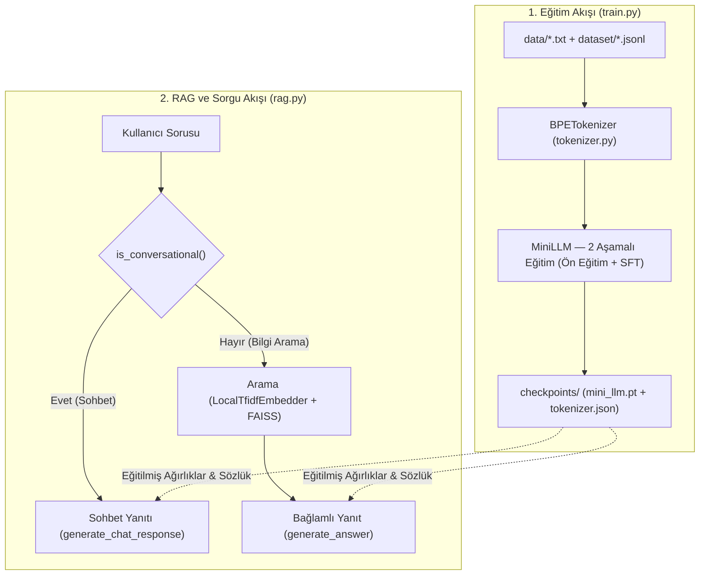

# Kişisel RAG — Sıfırdan Yerel Mini-LLM + RAG Asistanı

MiniLM, TinyLlama veya Hugging Face `transformers` gibi hazır dış modellere bağımlı olmadan; **BPE tokenizer**, **yerel TF-IDF gömme (embedder)**, **FAISS vektör araması** ve **PyTorch tabanlı Mini-LLM (Causal Transformer)** bileşenlerini sıfırdan eğitip çalıştıran açık kaynaklı, tamamen yerel bir Türkçe Sohbet ve RAG (Erişim Destekli Üretim) asistanıdır.

---

## Proje Hakkında

Bu proje, harici API'lere veya internetten indirilen hazır dil/gömme modellerine ihtiyaç duymadan uçtan uca bir RAG ve sohbet sisteminin nasıl kurulduğunu göstermek ve kendi verilerinizle kolayca özelleştirilebilir hafif bir temel sunmak amacıyla geliştirilmiştir:

- **Sıfır Hazır Model Bağımlılığı:** `requirements.txt` yalnızca `torch`, `numpy` ve `faiss-cpu` içerir. `sentence_transformers`, `transformers`, `accelerate` veya `huggingface_hub` kullanılmaz.
- **Tamamen Yerel & Gizlilik Odaklı:** Tokenizer sözlüğü, vektör indeksi ve dil modeli ağırlıkları kendi bilgisayarınızda oluşturulur ve çalışır.
- **Çift Modlu Asistan:** Gündelik Türkçe sohbet sorularını doğrudan sohbet istemiyle yanıtlarken, bilgi gerektiren sorularda `data/` altındaki belgelerden FAISS ile bağlam getirip belgeye dayalı yanıt üretir. İlgili bağlam bulunamadığında uydurma yapmak yerine `"Malesef aradığınız bilgi elimde yok."` yanıtını verir.
- **Eğitilebilir ve Genişletilebilir:** Kendi `.txt` belgelerinizi ve `.jsonl` soru-cevap/sohbet veri setlerinizi ekleyerek modeli dakikalar içinde yeniden eğitebilirsiniz.

---

## Mimari Akış



1. **Eğitim Akışı (`train.py`):** `data/*.txt` ve `dataset/*.jsonl` verilerinden `BPETokenizer` eğitilir; ardından `MiniLLM` önce bilgi metinleri üzerinde nedensel dil modeli ön eğitiminden (Aşama 1), sonrasında sohbet + RAG soru-cevap verileriyle denetimli ince ayardan / SFT (Aşama 2) geçirilerek `checkpoints/` klasörüne kaydedilir.
2. **RAG ve Sorgu Akışı (`rag.py`):** Kullanıcı sorusu önce `is_conversational()` yönlendiricisinden geçer. Gündelik sohbet soruları doğrudan `generate_chat_response()` ile yanıtlanır. Bilgi araması gereken sorular `LocalTfidfEmbedder` + FAISS `IndexFlatIP` ile `index/` içinde aranır; eşleşen parçalar (`TOP_K=2`, `MIN_SCORE=0.05`, `MIN_RATIO=0.55`) bağlam olarak paketlenip `generate_answer()` ile yanıtlanır.

---

## Temel Bileşenler & Dosya Yapısı

```text
.
├── tokenizer.py        # Sıfırdan BPE tokenizer ve özel sohbet/RAG token biçimlendiricileri
├── embedder.py         # Yerel Türkçe/İngilizce TF-IDF gömme motoru (LocalTfidfEmbedder)
├── model.py            # PyTorch nedensel Transformer mimarisi (MiniLLM & MiniLLMConfig)
├── train.py            # 2 aşamalı (ön eğitim + SFT) model eğitim hattı
├── rag.py              # Belge parçalama, FAISS indeksleme, yönlendirme ve terminal sohbet CLI
├── requirements.txt    # Minimal bağımlılıklar: torch, numpy, faiss-cpu
├── data/               # Yerel bilgi tabanı metinleri (ornek_tr.txt, sample.txt)
├── dataset/            # Eğitim JSONL veri kümeleri (everyday_tr.jsonl, rag_qa.jsonl)
├── index/              # FAISS indeksi ve parça metaverisi (faiss.index, chunks.json, embedder.json)
├── checkpoints/        # Eğitilmiş model (mini_llm.pt), tokenizer.json ve training_metrics.json
└── tests/              # Birim ve uçtan uca entegrasyon testleri (test_pipeline.py)
```

Repodaki mevcut eğitilmiş yapılandırma ve doğrulanan metrikler:

| Bileşen | Doğrulanan Değerler |
| :--- | :--- |
| **Dil Modeli (`model.py`)** | `MiniLLM` — **`3,807,488`** parametre, `n_layer=4`, `n_head=4`, `n_embd=256`, `block_size=576`, `dropout=0.08`, `bias=False`, ağırlık paylaşımlı çıkış katmanı (`lm_head.weight = token_emb.weight`) |
| **Tokenizer (`tokenizer.py`)** | `BPETokenizer` — **`vocab_size=2000`** (`1,884` BPE birleştirme), 7 özel token (`<\|pad\|>`, `<\|bos\|>`, `<\|eos\|>`, `<\|unk\|>`, `<\|context\|>`, `<\|user\|>`, `<\|assistant\|>`) |
| **Gömme & Vektör İndeksi (`embedder.py`, `index/`)** | `LocalTfidfEmbedder` — `max_features=4096`, `ngram_range=(3, 4)`, L2-normalize `float32` vektörler (`dim=4096`), FAISS `IndexFlatIP` içinde **`13` chunk** (`ornek_tr.txt`: 5, `sample.txt`: 8) |
| **Veri Kümesi (`dataset/`)** | Toplam **`748`** ham örnek: `everyday_tr.jsonl` (`460` gündelik sohbet) + `rag_qa.jsonl` (`288` bağlamlı soru-cevap, `53` adet olumsuz/"belgelerde yer almıyor" örneği dahil); veri artırımı sonrası `3,475` eğitim örneği |
| **Eğitim Metrikleri (`checkpoints/training_metrics.json`)** | `val_split=0.0`, `pretrain_epochs=25`, `epochs=150`, en iyi epoch `149`, `best_train_loss=0.1556` (`NVIDIA GeForce RTX 4060 Laptop GPU` üzerinde `692.86` sn) |

---

## Kurulum

### 1. Depoyu Klonlayın ve Sanal Ortam Oluşturun

```bash
git clone https://github.com/MuratDemions/try_RAG.git
cd try_RAG
python -m venv .venv
```

Sanal ortamı etkinleştirin:

- **Windows (PowerShell):**
  ```powershell
  .\.venv\Scripts\Activate.ps1
  ```
- **Linux / macOS:**
  ```bash
  source .venv/bin/activate
  ```

### 2. Bağımlılıkları Yükleyin

Standart (CPU) kurulum için:

```bash
pip install -r requirements.txt
```

`requirements.txt` içeriği:
- `torch>=2.2.0`
- `numpy>=1.26.0`
- `faiss-cpu>=1.8.0`

> [!TIP]
> **NVIDIA GPU (CUDA) Kullanıcıları İçin:** Standart `pip install -r requirements.txt` komutu PyTorch'un CPU sürümünü kurabilir. Eğitimi GPU üzerinde çalıştırmak için önce sisteminizdeki CUDA sürücüsüne uygun PyTorch tekerleğini (örneğin `--index-url https://download.pytorch.org/whl/cu126` veya CUDA 13 ortamı için `cu130` — bu proje `torch-2.14.1+cu130` ile doğrulanmıştır) yükleyip ardından kalan bağımlılıkları kurabilirsiniz:
> ```bash
> pip install torch --index-url https://download.pytorch.org/whl/cu126
> pip install -r requirements.txt
> ```

---

## Kullanım

### 1. Modeli Sıfırdan Eğitme

```bash
# Varsayılan eğitim (CUDA varsa otomatik kullanır, %10 doğrulama bölütü ayırır)
python train.py

# Doğrulama bölütü ayırmadan tüm veriyle eğitim (repodaki checkpoint ile aynı düzen)
python train.py --val-split 0.0

# Cihazı açıkça seçme (otomatik algılama veya yalnızca CPU)
python train.py --device auto
python train.py --device cpu
```

Eğitim tamamlandığında `checkpoints/mini_llm.pt`, `checkpoints/tokenizer.json` ve `checkpoints/training_metrics.json` dosyaları güncellenir.

### 2. Bilgi Tabanı İndeksini Oluşturma ve Etkileşimli Sohbet

`data/` içindeki `.txt` dosyalarından FAISS indeksini oluşturup terminal sohbetini başlatmak için:

```bash
python rag.py --rebuild
```

İndeks bir kez oluşturulduktan sonra sonraki çalıştırmalarda doğrudan mevcut indeksi yükleyebilirsiniz:

```bash
python rag.py
```

Sohbet sırasında çıkmak için `exit`, `quit` veya `q` yazabilirsiniz.

### 3. Tek Sorgu Modu (Non-Interactive)

Terminal döngüsüne girmeden tek bir soru sormak için:

```bash
python rag.py --query "Yapay zeka nedir?"
```

Diğer yararlı `rag.py` CLI bayrakları:
- `--data <klasör>`: `.txt` belgelerinin okunacağı klasör (varsayılan `./data`)
- `--model <dosya>` / `--tokenizer <dosya>`: Özel model veya tokenizer yolu
- `--temperature <değer>`: Örnekleme sıcaklığı (varsayılan `0.0`, deterministik greedy)
- `--top-k <sayı>`: Üretimde top-k kesme değeri (varsayılan `20`)
- `--max-new-tokens <sayı>`: Üretilecek en fazla token sayısı (varsayılan `128`)
- `--debug`: Ayrıntılı günlük çıktısını açar

---

## Kendi Verinizle Özelleştirme & Eğitim

### Yalnızca Bilgi Tabanını Güncelleme (Yeniden Eğitim Olmadan)

1. `data/` klasörüne UTF-8 kodlamalı yeni `.txt` dosyaları ekleyin (konuları boş satırlarla paragraflara ayırmanız `chunk_document` parçalama kalitesini artırır).
2. İndeksi yeniden oluşturun:
   ```bash
   python rag.py --rebuild
   ```

### Kendi Sohbet / Soru-Cevap Verinizle Modeli Yeniden Eğitme

1. `dataset/` klasörüne kendi `.jsonl` dosyalarınızı ekleyin veya mevcut dosyaları genişletin:
   - **Gündelik sohbet kaydı:**
     ```json
     {"user": "merhaba, neler yapabilirsin?", "assistant": "Merhaba! Yerel belgelerinizde arama yapıp sorularınızı yanıtlayabilirim."}
     ```
   - **Bağlama dayalı RAG soru-cevap kaydı:**
     ```json
     {"context": "Belge metni buraya gelir.", "user": "Bu belgede ne anlatılıyor?", "assistant": "Belgeye göre ..."}
     ```
   - Bağlamda cevabı bulunmayan sorular için olumsuz örnekler (`"assistant": "Bu bilgi elimdeki belgelerde yer almıyor."`) eklemeniz modelin uydurma yanıt üretmesini önlemeye yardımcı olur.
2. Modeli yeniden eğitin ve indeksi güncelleyin:
   ```bash
   python train.py --val-split 0.0
   python rag.py --rebuild
   ```

### Önemli Eğitim CLI Parametreleri (`train.py`)

| Parametre | Varsayılan | Açıklama |
| :--- | :--- | :--- |
| `--epochs` | `150` | Aşama-2 denetimli ince ayar (SFT) epoch sayısı |
| `--pretrain-epochs` | `25` | Aşama-1 dil modeli ön eğitim epoch sayısı (`0` ile atlanır) |
| `--n-layer` | `4` | Transformer blok/katman sayısı |
| `--n-embd` | `256` | Gömme (embedding) boyutu (`--n-head` ile tam bölünmelidir; varsayılan `--n-head 4`) |
| `--vocab-size` | `2000` | BPE tokenizer hedef sözlük boyutu |
| `--lr` | `2e-3` | SFT öğrenme oranı (ön eğitim için ayrıca `--pretrain-lr`, varsayılan `2e-3`) |
| `--rag-upsample` | `1` | Eğitim bölütündeki RAG örneklerinin tekrar katsayısı |
| `--val-split` | `0.1` | Doğrulama bölütü oranı (`0.0` ile tüm ham veri eğitime dahil edilir) |
| `--block-size` | `576` | Maksimum bağlam penceresi uzunluğu (token) |
| `--rag-distractor-aug` | `1` | Her pozitif RAG eğitim örneği için çok parçalı (`---`) dikkat dağıtıcı bağlam üretimi |
| `--device` | `auto` | Çalışma cihazı (`auto`, `cuda`, `cpu`) |

---

## Testler

Projede `BPETokenizer`, `LocalTfidfEmbedder`, `MiniLLM` ve `rag.py` uçtan uca akışlarını doğrulayan birim ve entegrasyon testleri bulunur. Testler izole geçici dizinler kullanır ve mevcut `checkpoints/` veya `index/` dosyalarınızı değiştirmez:

```bash
python -m unittest discover -s tests -v
```

---

## Katkıda Bulunma (Fork & PR)

Katkılarınız memnuniyetle karşılanır:

1. Repoyu GitHub üzerinden **Fork**layın.
2. Yeni bir geliştirme dalı oluşturun:
   ```bash
   git checkout -b ozellik/yeni-gelistirme
   ```
3. Değişikliklerinizi yapın; projenin **sıfır hazır dış model** ilkesini (`sentence_transformers`, `transformers`, `huggingface_hub` gibi bağımlılıklar eklememeyi) koruyun.
4. Tüm testlerin geçtiğini doğrulayın:
   ```bash
   python -m unittest discover -s tests -v
   ```
5. Değişikliklerinizi commit edip dalınızı pushlayın ve bir **Pull Request** açın.
